<p align="center">
  <a href="https://ncircle.me"></a>
</p>

<h3 align="center">Study smarter, together.</h3>

<p align="center">The study community for NSBM students: share notes, ask questions,<br>form study groups and find the right people to work with.</p>

<p align="center">
  
  
  
  
  
  <br>
  
  
  
  
</p>

<p align="center">
  <a href="https://ncircle.me"><b>🌐 Live website</b></a> &nbsp;•&nbsp;
  <a href="https://www.figma.com/design/jgbT62qa7rqlf6dg9fErZ8/Ncircle?node-id=62-5"><b>🎨 Figma design</b></a> &nbsp;•&nbsp;
  <a href="docs/DATABASE.md"><b>🗄️ Database design</b></a> &nbsp;•&nbsp;
  <a href="#-getting-started"><b>🚀 Run it locally</b></a>
</p>

<p align="center">
  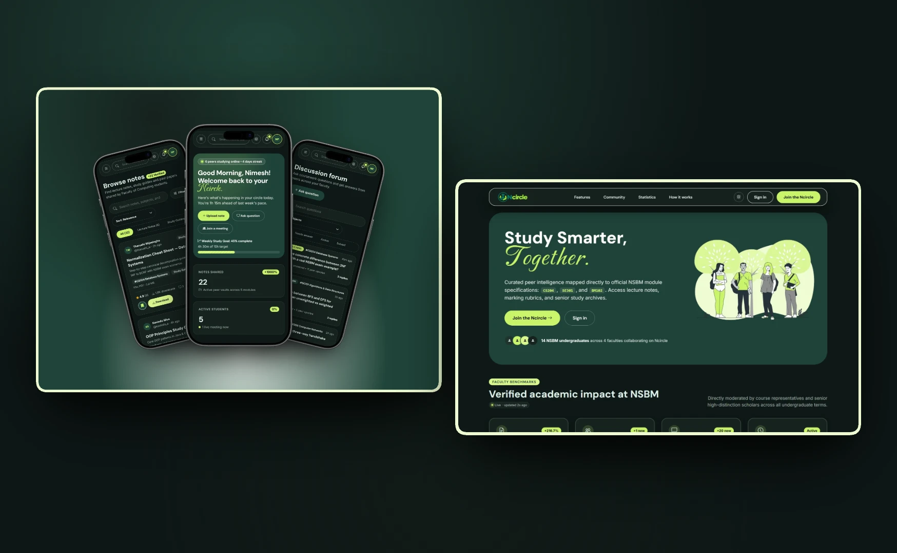
</p>

## 📖 Contents

- [About](#-about)
- [Features](#-features)
- [Screenshots](#-screenshots)
- [Tech stack](#-tech-stack)
- [Architecture](#-architecture)
- [Database](#-database)
- [Security](#-security)
- [Getting started](#-getting-started)
- [Testing](#-testing)
- [Deployment](#-deployment)
- [Team](#-team)

## 💡 About

Study material at university is usually scattered across chat groups and personal drives. **Ncircle** brings it into one place, where admins review every note and only people with an NSBM student email can join.

It is our **Web Development module group project (Group 3)** at NSBM Green University. The backend is written in plain PHP with **no framework**: we built the router, MVC core, authentication and validation ourselves.

## ✨ Features

| | Feature | What students can do |
|:-:|---|---|
| 📚 | **Notes vault** | Share PDF, DOCX and PPTX notes. Filter, rate, bookmark, comment and download |
| 💬 | **Discussion forum** | Ask, answer, upvote and accept answers, with images, files, emoji and GIFs |
| 👥 | **Study groups** | Create and join groups by subject, and post on a private group wall |
| 📅 | **Meetings** | Schedule online, physical or hybrid sessions with limited seats |
| 🔎 | **Find Members** | Post help requests and find peers by skill, across all faculties |
| 📈 | **Dashboard and study space** | Set a weekly goal, log study time, and follow live charts |
| 🔔 | **Notifications** | Hear about answers, approvals, meetings and responses |
| 🛡️ | **Admin panel** | Approve notes, moderate reports, manage users and subjects, export CSV |
| 🌗 | **Light and dark themes** | Responsive pages that also respect reduced-motion settings |

## 📸 Screenshots

### 🖥️ Desktop

<table align="center">
  <tr>
    <td align="center" width="50%">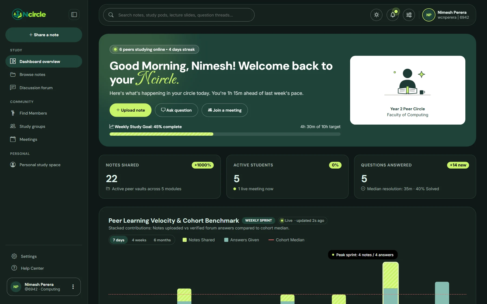<br><b>Dashboard</b></td>
    <td align="center" width="50%">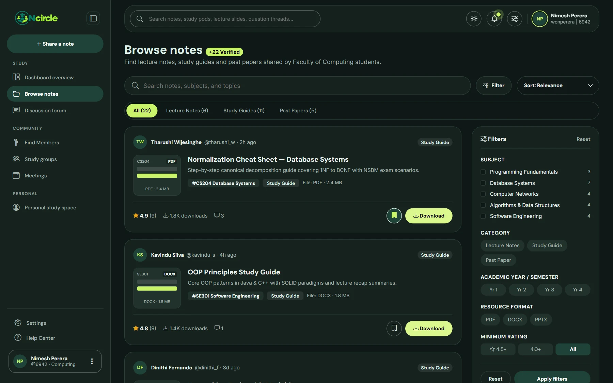<br><b>Browse notes</b></td>
  </tr>
  <tr>
    <td align="center" width="50%">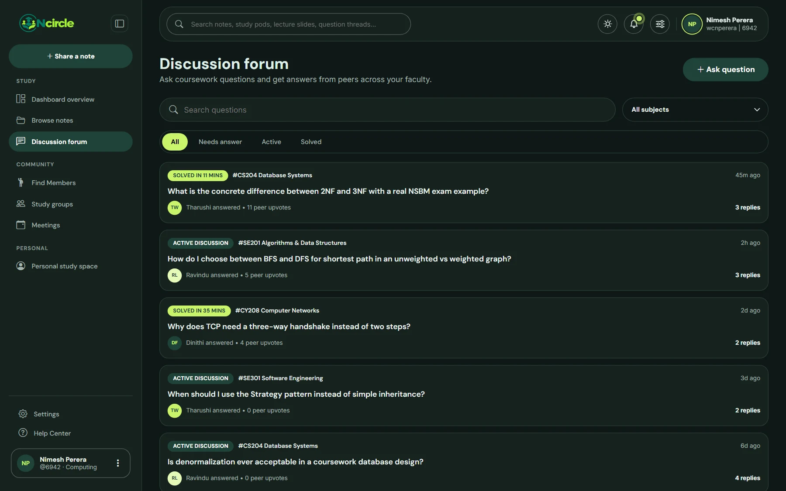<br><b>Discussion forum</b></td>
    <td align="center" width="50%">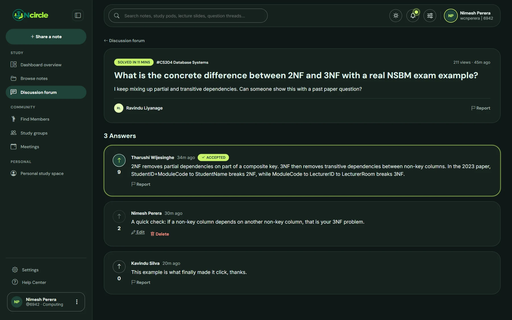<br><b>Forum thread</b></td>
  </tr>
  <tr>
    <td align="center" width="50%">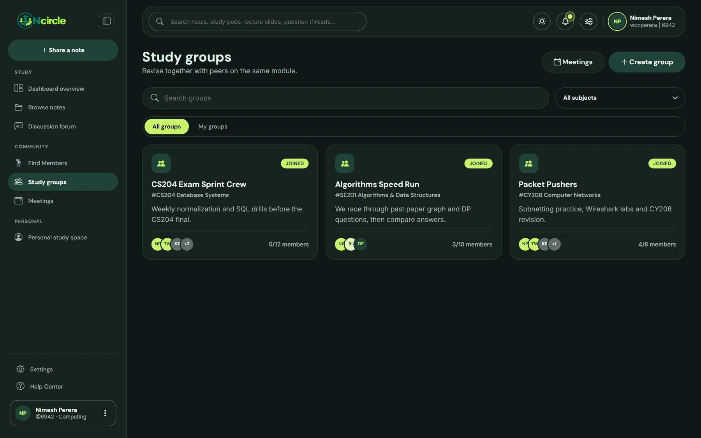<br><b>Study groups</b></td>
    <td align="center" width="50%">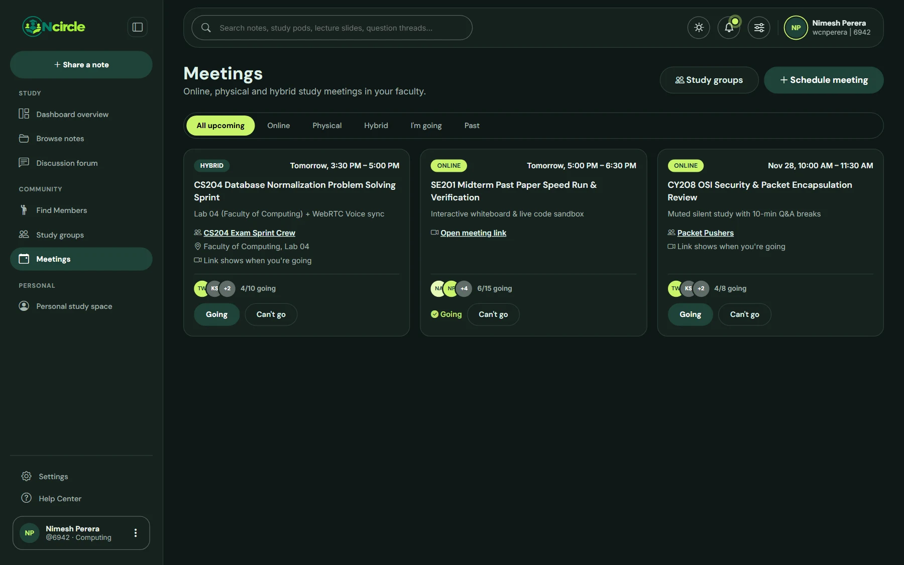<br><b>Meetings</b></td>
  </tr>
  <tr>
    <td align="center" width="50%">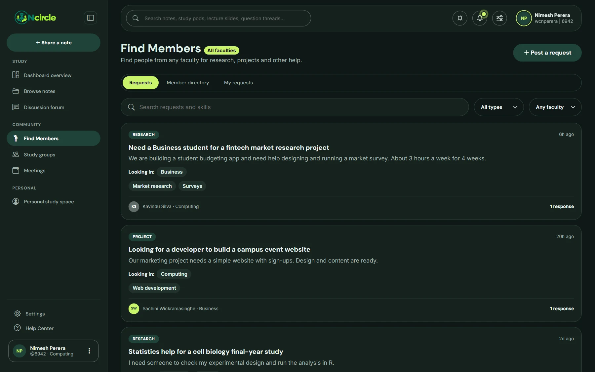<br><b>Find Members</b></td>
    <td align="center" width="50%">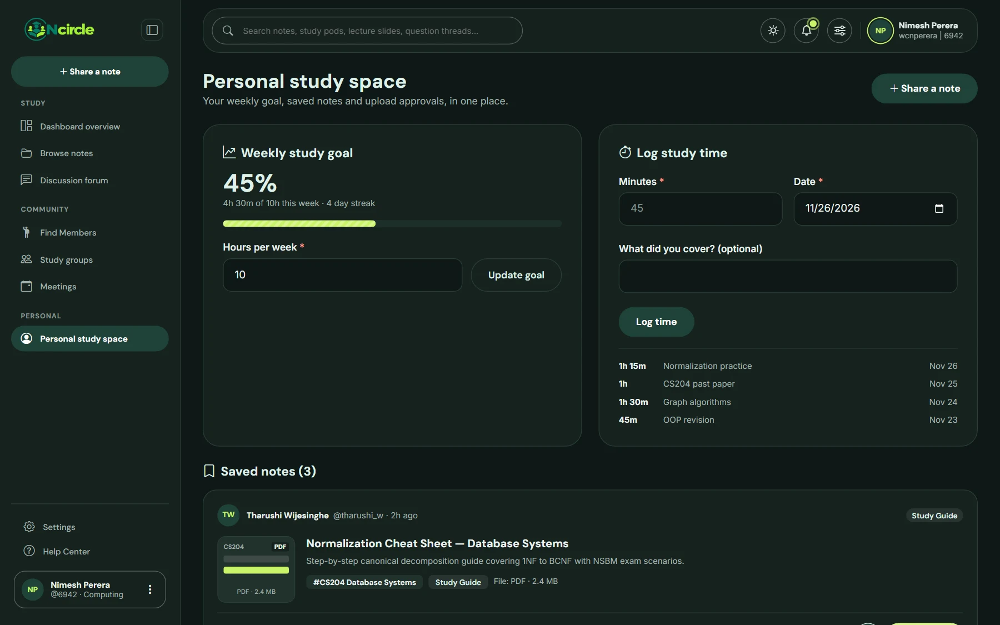<br><b>Personal study space</b></td>
  </tr>
  <tr>
    <td align="center" width="50%">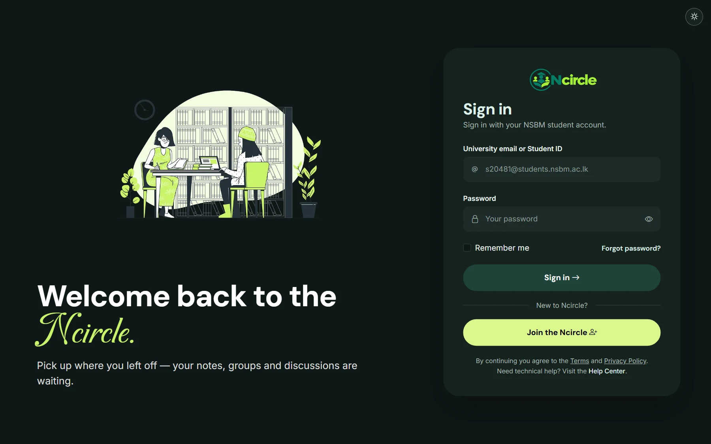<br><b>Sign in</b></td>
    <td align="center" width="50%">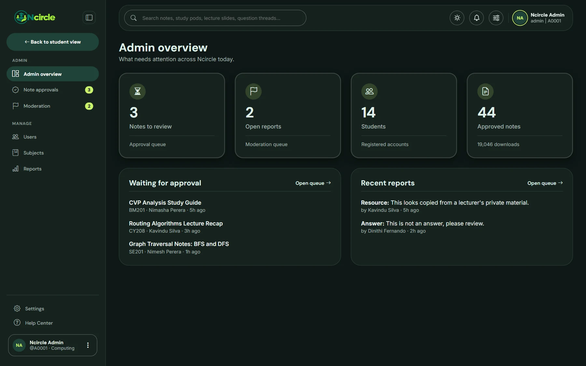<br><b>Admin overview</b></td>
  </tr>
</table>

### 📱 Mobile

<table align="center">
  <tr>
    <td align="center" width="33%">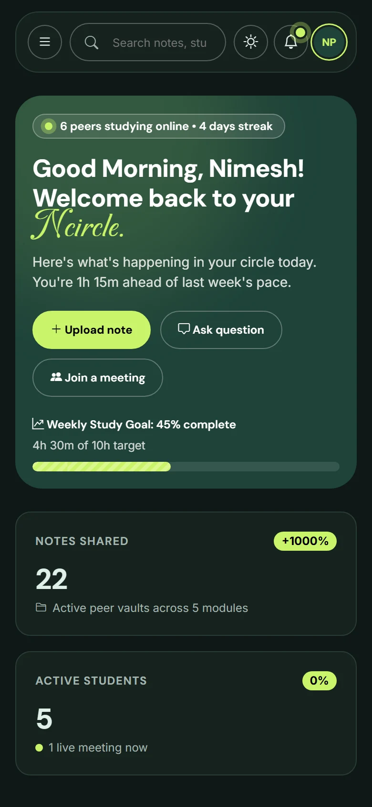<br><b>Dashboard</b></td>
    <td align="center" width="33%">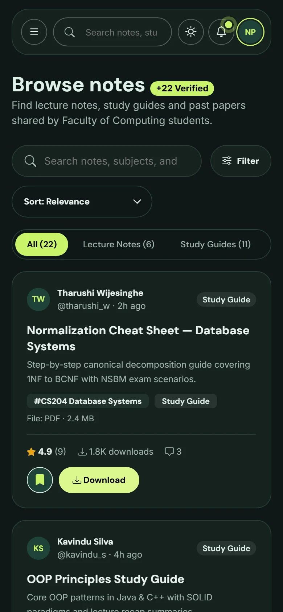<br><b>Browse notes</b></td>
    <td align="center" width="33%">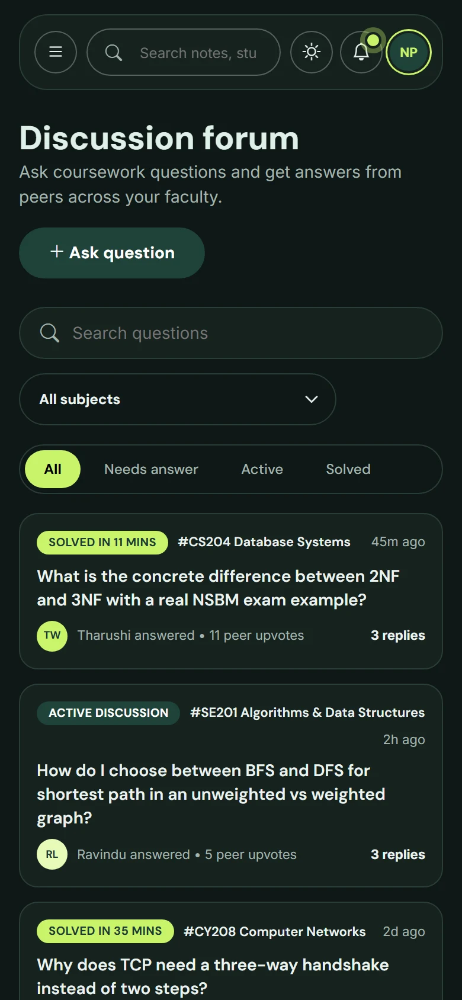<br><b>Discussion forum</b></td>
  </tr>
</table>

<p align="center"><sub>Screenshots use made-up demo data. A light theme is available too.</sub></p>

## 🧰 Tech stack

| Layer | Technology |
|---|---|
| **Frontend** | HTML5, CSS with custom properties, vanilla JavaScript, Bootstrap 5.3.3, Bootstrap Icons 1.13.2 |
| **Backend** | PHP 8.1+, custom MVC, no framework and no Composer packages |
| **Database** | MySQL or MariaDB through PDO |
| **Email** | [Resend](https://resend.com) API |
| **GIFs** | [GIPHY](https://developers.giphy.com) API, called from the server |
| **Design** | Figma, with self-hosted DM Sans, Inter and Carattere fonts |
| **Hosting** | Ubuntu server with Nginx |
| **Planning** | Notion |
| **Version control** | Git and GitHub, with feature branches and pull requests |

## 🏗 Architecture

Every request enters through one front controller and follows the same path:

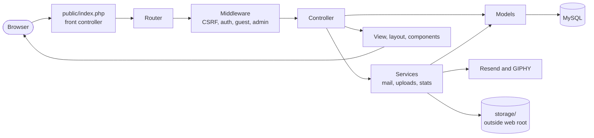

**How a student account is verified**

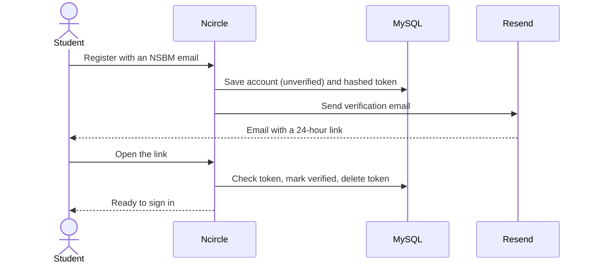

<details>
<summary><b>📁 Project structure</b></summary>

```text
studycircle/
├── app/
│   ├── Controllers/     Request handlers, with Admin/ for the admin panel
│   ├── Core/            Router, Database, Auth, Session, CSRF, Validator
│   ├── Helpers/         Global helper functions
│   ├── Middleware/      Auth, guest, admin and CSRF checks
│   ├── Models/          All SQL queries
│   └── Services/        Mail, uploads, file checks, notifications, stats
├── config/              App, database and upload settings
├── database/            Schema, seed data and migrations
├── docs/                Database design, demo accounts, screenshots
├── public/              Web root: index.php and assets only
├── routes/web.php       Every URL, and who can open it
├── storage/             Uploads, logs and cache, not public
├── tests/smoke.php      End-to-end tests
└── views/               Pages, layouts, partials, components, emails
```

Shared components are shown at `/dev/styleguide` when `APP_DEBUG=true`. Colours, fonts and radii live in `public/assets/css/theme.css`.

</details>

## 🗄 Database

**25 tables** in five modules. This diagram shows the core tables and their main links. **[See the full database design](docs/DATABASE.md)** for every table, column and key.

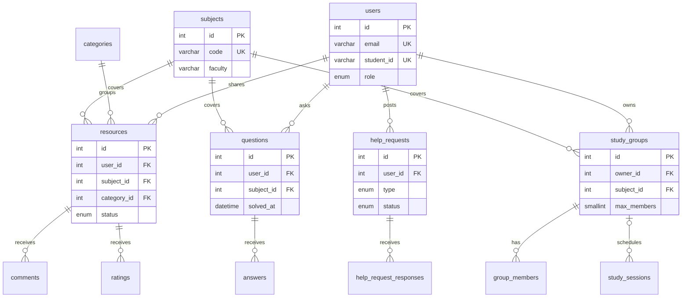

| Module | Tables |
|---|---|
| Accounts | `users` `user_tokens` `login_attempts` `notifications` `study_logs` |
| Notes | `subjects` `categories` `resources` `ratings` `downloads` `comments` `bookmarks` |
| Forum | `questions` `answers` `answer_votes` `attachments` |
| Groups and meetings | `study_groups` `group_members` `group_posts` `study_sessions` `session_attendees` |
| Find Members and moderation | `help_requests` `help_request_faculties` `help_request_responses` `reports` |

## 🔐 Security

| Risk | Protection |
|---|---|
| SQL injection | PDO prepared statements with emulation turned off |
| XSS | Escaped output and a nonce-based Content Security Policy |
| CSRF | Token checked automatically on every POST route |
| Stolen passwords | `password_hash()`, with sign-in limited to 5 failed tries per 15 minutes |
| Session attacks | HttpOnly and SameSite cookies, with the session ID renewed at sign-in |
| Fake accounts | NSBM student emails only, confirmed by a single-use link |
| Dangerous uploads | Checked by content, given random names and stored outside the web root |
| Clickjacking and sniffing | `X-Frame-Options`, `X-Content-Type-Options` and referrer headers |
| Wrong access | Role, ownership and faculty checks on the server |

## 🚀 Getting started

**You need:** PHP 8.1+ with `pdo_mysql`, `fileinfo`, `mbstring`, `zip` and `curl`, plus MySQL or MariaDB.

```bash
# 1. Clone
git clone https://github.com/TheekshanaCN/studycircle.git
cd studycircle

# 2. Configure: fill in your database details
cp .env.example .env

# 3. Create the database and import it (schema.sql wipes existing tables)
mysql -u <user> -p -e "CREATE DATABASE ncircle CHARACTER SET utf8mb4"
mysql -u <user> -p ncircle < database/schema.sql
mysql -u <user> -p ncircle < database/seed.sql

# 4. Start
php -d upload_max_filesize=10M -d post_max_size=22M -S localhost:8000 -t public public/index.php
```

Set `DB_NAME=ncircle` in `.env`, open <http://localhost:8000> and sign in with an account from [docs/DEMO_ACCOUNTS.md](docs/DEMO_ACCOUNTS.md).

<details>
<summary><b>⚙️ Environment variables</b></summary>

| Variable | Purpose |
|---|---|
| `APP_NAME`, `APP_ENV` | Site name and environment |
| `APP_DEBUG` | Shows error details and dev pages. **Must be `false` when live** |
| `APP_URL` | Base address for links in emails when debug is off |
| `DB_HOST`, `DB_PORT`, `DB_NAME`, `DB_USER`, `DB_PASS` | Database connection |
| `MAIL_DRIVER` | `log` writes to `storage/logs/mail.log`, `resend` sends real email, `mail` uses PHP `mail()` |
| `RESEND_API_KEY` | Needed when `MAIL_DRIVER=resend` |
| `MAIL_FROM_ADDRESS`, `MAIL_FROM_NAME` | Sender. The domain must be verified at Resend |
| `GIPHY_API_KEY` | Optional. Without it, the GIF button is hidden |

</details>

<details>
<summary><b>🔄 Updating an existing database</b></summary>

Back up first, then run each new file in `database/migrations/` once, in date order:

```bash
mysqldump -u <user> -p <database> > backup.sql
mysql -u <user> -p <database> < database/migrations/2026-11-25-profile-photos.sql
```

</details>

## 🧪 Testing

The end-to-end suite makes **483 checks** over real HTTP, covering access control, uploads, XSS, CSRF, moderation and more.

Always use a separate test database with freshly imported `schema.sql` and `seed.sql`, because the tests create accounts and content.

```bash
# Terminal 1
MAIL_DRIVER=log DB_NAME=ncircle_test php -d upload_max_filesize=10M -d post_max_size=22M -S 127.0.0.1:8770 -t public public/index.php

# Terminal 2
php tests/smoke.php http://127.0.0.1:8770
```

Values set on the command line override `.env`, and `APP_DEBUG` must be `true`. To include the GIF checks, also run `php -S 127.0.0.1:8799 tests/giphy-mock.php` and start the server with `GIPHY_API_KEY=test-secret-key GIPHY_API_BASE=http://127.0.0.1:8799/v1`.

## 👥 Team

**Group 3, NSBM Green University**

| | Member | GitHub | Contribution |
|:-:|---|---|---|
|  | **TheekshanaCN** | [@TheekshanaCN](https://github.com/TheekshanaCN) | MVC core, database, admin panel, email, tests |
|  | **wkravindulakshan** | [@wkravindulakshan](https://github.com/wkravindulakshan) | Design system, layouts, shared components |
|  | **Terasha Sithmi** | [@Terashasith](https://github.com/Terashasith) | Notes vault, ratings, landing metrics |
|  | **Kaleimagan-s** | [@Kaleimagan-s](https://github.com/Kaleimagan-s) | Sign in, register, verification, reset |
|  | **Thashu25** | [@Thashu25](https://github.com/Thashu25) | Study groups, meetings, landing structure |
|  | **amaJayasekara** | [@amaJayasekara](https://github.com/amaJayasekara) | Forum, composer with files and GIFs |
|  | **SanduniCW** | [@SanduniCW](https://github.com/SanduniCW) | Find Members, profiles, study space |
|  | **nimthara-TN** | [@nimthara-TN](https://github.com/nimthara-TN) | Dashboard, notifications, search, info pages |


<div align="center">
  <br>
  <b>Made by Group 3 at NSBM Green University</b><br>
  <a href="https://ncircle.me">ncircle.me</a>
</div>
