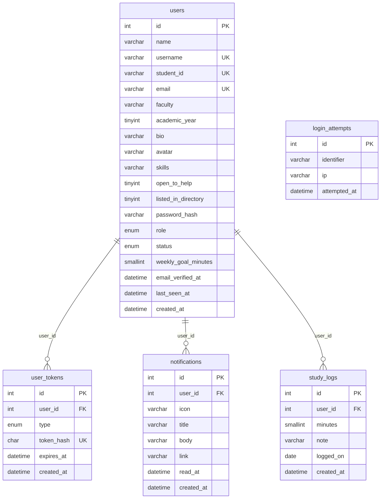
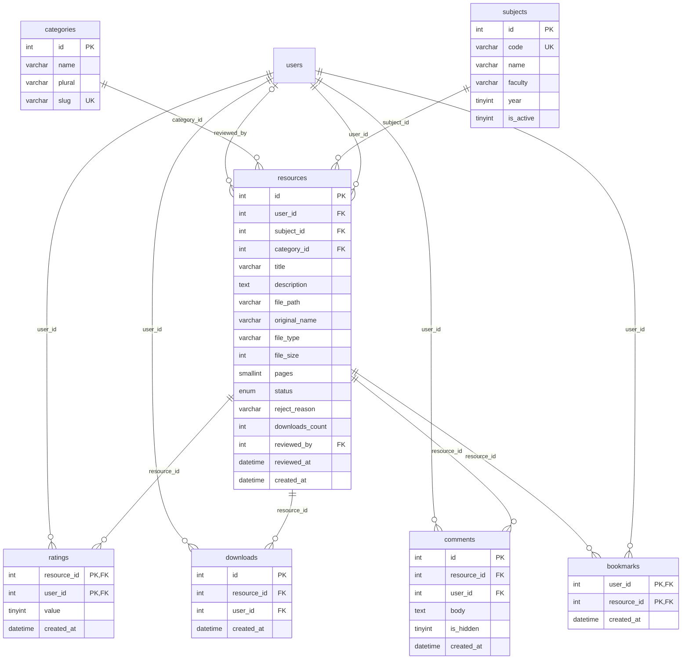
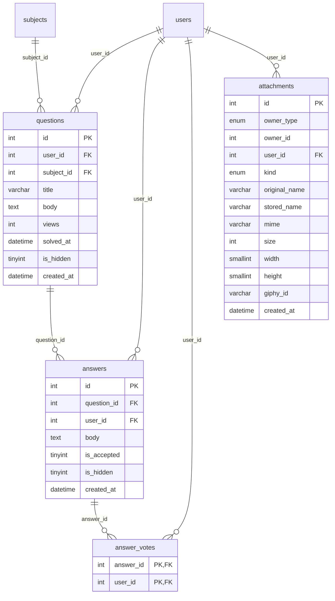
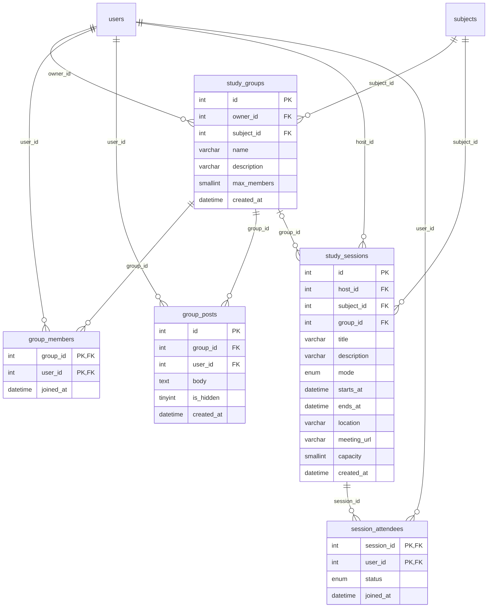
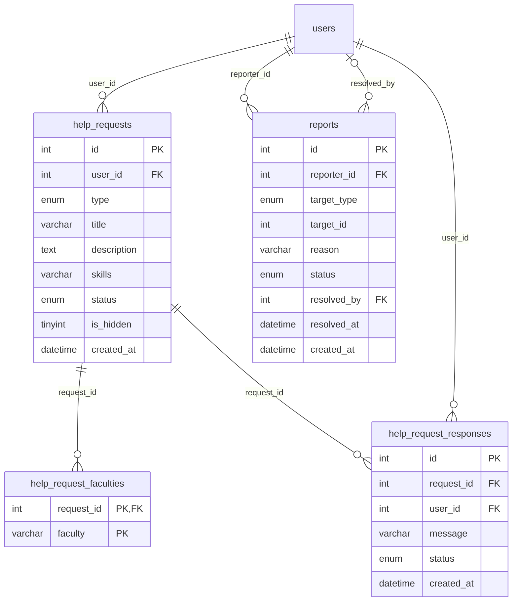

# Database design

Ncircle uses **25 InnoDB tables** in `utf8mb4`, defined in [`database/schema.sql`](../database/schema.sql).

- **PK** primary key, **FK** foreign key, **UK** unique.
- Each table shows every column once, in its own section. A table from another section appears as a name only.
- `attachments` and `reports` point at several kinds of content (`owner_type` + `owner_id`, `target_type` + `target_id`), so that link is checked in PHP and has no foreign key.

## Accounts

## Notes

## Forum and attachments

## Study groups and meetings

## Find Members and moderation

## Design rules

| Rule | How it is enforced |
|---|---|
| One rating, bookmark, vote or membership per person | Composite primary keys |
| One report per person per item, one response per request | Unique keys |
| Deleting an account removes that person's own content | `ON DELETE CASCADE` |
| Moderation history survives a removed admin | `ON DELETE SET NULL` on `reviewed_by` and `resolved_by` |
| A meeting survives its group being deleted | `ON DELETE SET NULL` on `group_id` |
| Seats and member limits cannot be oversold | Row locks (`SELECT ... FOR UPDATE`) inside transactions |
| Tokens are useless if the database leaks | Only a SHA-256 hash is stored, with an expiry |

## Migrations

Run new files in [`database/migrations/`](../database/migrations) once, in date order. They keep existing data. Importing `schema.sql` **wipes** it.
